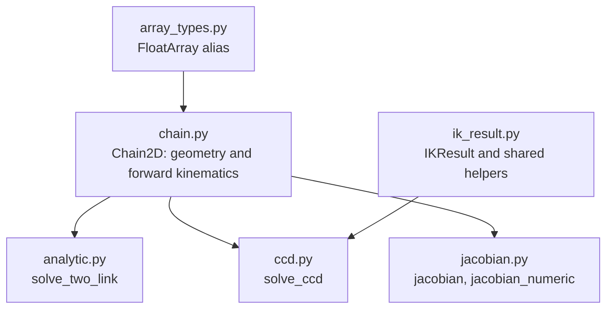

# Inverse kinematics solver

Given a robot arm and a target point, find the joint angles that put the arm's tip on the target. This is the inverse kinematics (IK) problem. This repo solves it for planar (2D) arms, built from scratch on top of NumPy.

I’m learning robotics by building it, so the code favors clarity and tests over features. A live demo of the two-link solver (a JavaScript port) is on [my site](https://sxhnd.github.io/).

## Status

| Piece | State |
| --- | --- |
| Forward kinematics, any number of links | Done |
| Analytic solver, two links (exact, both elbow poses) | Done |
| Cyclic coordinate descent (CCD) solver, any number of links | Done |
| Planar Jacobian, exact and numeric | Done |
| Jacobian-based solvers (pseudo-inverse, damped least squares) | Next. The Jacobian is in place for them |
| Obstacles, joint limits, dynamics, reinforcement learning | Not started |

## Quick start

Needs Python 3.12 or later and [uv](https://docs.astral.sh/uv/).

```sh
git clone https://github.com/sxhnd/IK_Solver.git
cd IK_Solver
uv sync
uv run pytest -q
```

### Two links: exact answer

```python
from ik.analytic import solve_two_link
from ik.chain import Chain2D

arm = Chain2D([1.0, 0.6])  # two links, lengths 1.0 and 0.6
target = [0.9, 0.7]

for angles in solve_two_link(arm, target):  # elbow-down, then elbow-up
    print("angles (radians):", angles.round(4))
    print("tip:", arm.end_effector(angles).round(4))
```

You get two angle pairs, each placing the tip at `[0.9, 0.7]`. An unreachable target gives an empty list.

### Any number of links: iterative answer

```python
from ik.ccd import solve_ccd
from ik.chain import Chain2D

arm = Chain2D([1.0, 0.8, 0.5])
result = solve_ccd(arm, [1.5, 1.0])

print(result.is_converged)  # True
print(result.iterations)    # 4
print(result.error)         # distance from tip to target, about 6e-05
print(result.q.round(3))    # [0.145 0.367 1.442]
```

An unreachable target does not raise. The solver stops at the iteration limit with `is_converged == False`, so always check that flag.

### Conventions

- Angles are in radians and **relative**: `q[0]` is measured from the +x axis, and `q[i]` is measured from the direction of link `i - 1`.
- Link lengths and target coordinates share the same units.
- Positions are NumPy arrays: `(2,)` for a point, `(n + 1, 2)` for the base, every joint and the tip.

## How it fits together



- **`Chain2D` is the core.** It holds the arm (link lengths and base position) and answers one question: given joint angles, where is everything? Every solver builds on it. It validates its inputs and makes its arrays read-only, so a chain can't be broken after it's created.
- **Solvers take a chain and a target and return angles.** `solve_two_link` is closed-form and returns a list of solutions. `solve_ccd` is iterative and returns an `IKResult`.
- **Iterative solvers share one result type.** `IKResult` holds the final angles, whether it converged, the iteration count, the error and the per-iteration history. Its `finish()` helper measures the error with forward kinematics instead of trusting the solver, so a buggy solver can't report success it didn't reach.
- **The Jacobian describes how each joint moves the tip.** `jacobian` computes it in closed form and `jacobian_numeric` by finite differences. The tests check each against the other. It is the building block for the next solvers.

### How CCD works

Cyclic coordinate descent sweeps the joints from the tip back to the base. At each joint it rotates the joint so the line from the joint to the tip points at the target. It repeats the sweep until the tip is within `tol` of the target or `max_iters` sweeps have run. It is simple and needs no matrix math, but it can take many sweeps and doesn't always find the neatest pose.

### Code map

| File | What's in it |
| --- | --- |
| [`ik/chain.py`](ik/chain.py) | `Chain2D`, `joint_positions`, `end_effector`, `wrap_angle` |
| [`ik/analytic.py`](ik/analytic.py) | `solve_two_link`: law of cosines, returns both elbow poses |
| [`ik/ccd.py`](ik/ccd.py) | `solve_ccd`: cyclic coordinate descent |
| [`ik/jacobian.py`](ik/jacobian.py) | `jacobian` (exact) and `jacobian_numeric` (finite differences) |
| [`ik/ik_result.py`](ik/ik_result.py) | `IKResult`, default tolerance and iteration limit, helpers |
| [`ik/array_types.py`](ik/array_types.py) | `FloatArray` type alias |
| [`tests/`](tests/) | One test file per module. `test_solvers.py` runs every iterative solver through the same checks |

To add a solver, write a function with the same signature as `solve_ccd`, return an `IKResult` through `finish()`, and add it to `SOLVERS` in `tests/test_solvers.py`. It then gets the shared tests for free.

## Development

```sh
uv run pytest -q          # tests
uv run ruff check .       # lint
uv run mypy               # strict type checking
uv run coverage run -m pytest && uv run coverage report   # fails under 90%
```

The code is fully type-annotated, and ruff and mypy (strict) pass on it.
